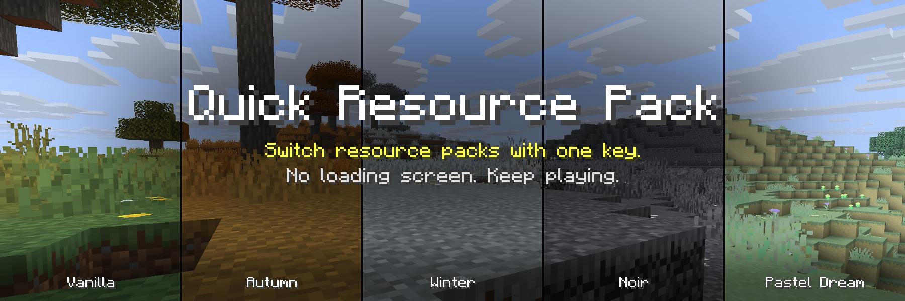
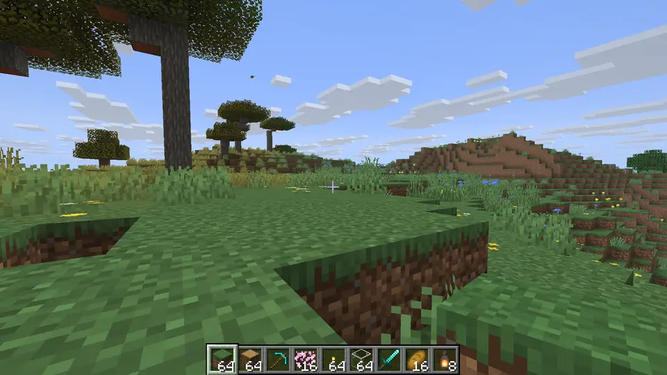
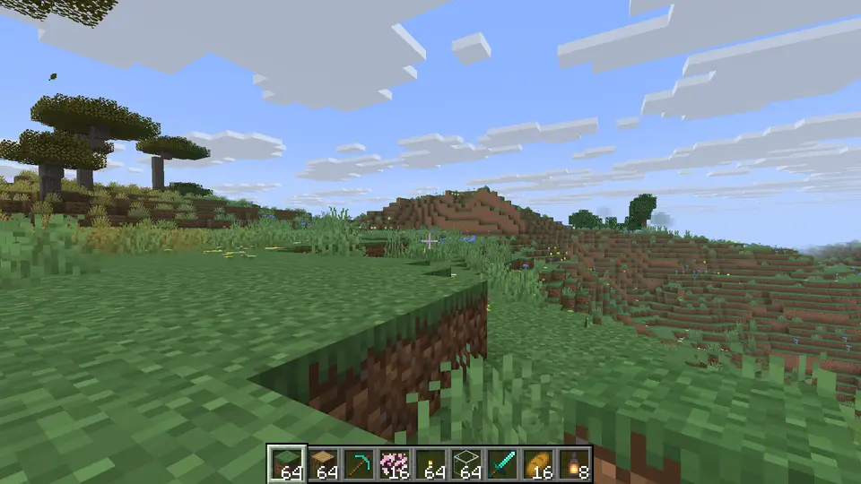
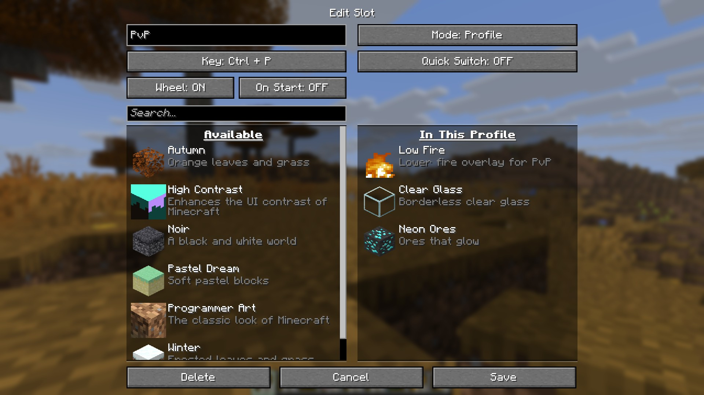
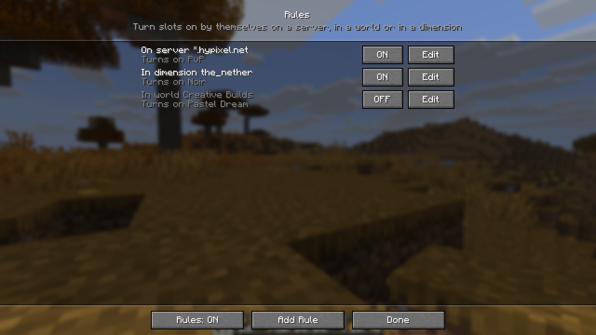

**Change how Minecraft looks without leaving the game.** Give your resource packs their own keys, pick one from a wheel, and keep playing while it loads. No menus, no loading screen.

## One key for every pack

Tap **R** to turn your main pack on or off. Hold **R** and the **Pack Wheel** opens: point at a pack, let go, and it's on. You can also click a slot or press 1 to 9.

The wheel is drawn with Minecraft's own hotbar, so it looks like part of the game.

## No loading screen

Changing packs normally freezes the game behind a loading screen. Quick Resource Pack loads them in the background instead. You keep walking, fighting and building, and a small toast shows the progress.

## Slots: any pack, any key

A slot is one or more packs with a key of their own. Shift, Ctrl and Alt combos work, and the editor warns you if Minecraft already uses that key.

Each slot works in one of three ways:

- **Toggle** puts its packs on top of the ones you already use. Press again to take them off. Good for small add-ons like low fire, clear glass or brighter ores.
- **Profile** swaps your whole pack list at once. Press again to get your old list back. One key for your PvP setup, another for your screenshot setup.
- **Cycle** steps through packs in order, like Autumn, then Winter, then off.

## Rules: packs that switch by themselves

Tell a slot when to turn on and forget about it:

- your PvP profile whenever you join a server (`*.example.net` covers every subdomain)
- a darker pack in the Nether
- a special pack for one singleplayer world

## Everything else

- **One menu for everything.** Open it from the button on the Resource Packs screen, from Mod Menu, with a key, or with `/qrp`.
- **Commands:** `/qrp toggle <slot>`, `/qrp wheel`, `/qrp list`, `/qrp reload`, `/qrp where`.
- **Pack icons on screen** (optional): see which slots are on, in a corner, like status effects.
- **Messages your way:** as a toast, above the hotbar, in chat, or off.
- **Client-side only:** works on every server, including vanilla ones. Nothing to install on the server.
- **Coming from 1.x?** Your pack, key and settings carry over automatically.

## Get started

1. Install [Fabric Loader](https://fabricmc.net/use/) and [Fabric API](https://modrinth.com/mod/fabric-api).
2. Put Quick Resource Pack in your `mods` folder.
3. Join a world and press **R**. The menu opens so you can make your first slot.

[Mod Menu](https://modrinth.com/mod/modmenu) is optional. Cloth Config is no longer needed.

## Versions

**2.0** is for Minecraft **26.3**. Versions for 26.1 and 26.2 are on the way.
Until then, nothing breaks: **1.2.0** still works on 26.2 and **1.1.1** on 26.1 and 1.21.x. Pick your game version on the Versions tab.

Found a bug or have an idea? [Open an issue on GitHub](https://github.com/emqnuele/quick-resource-pack/issues).
